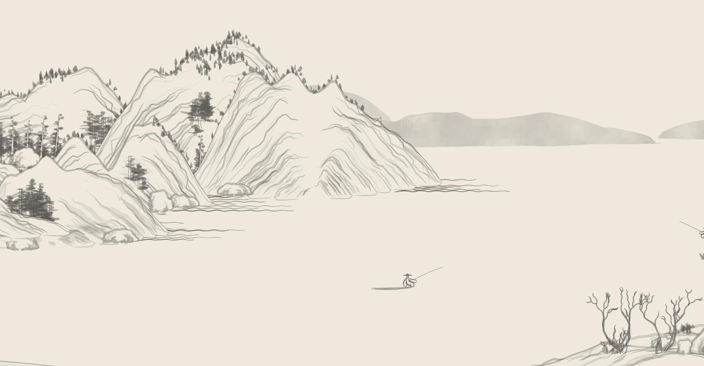
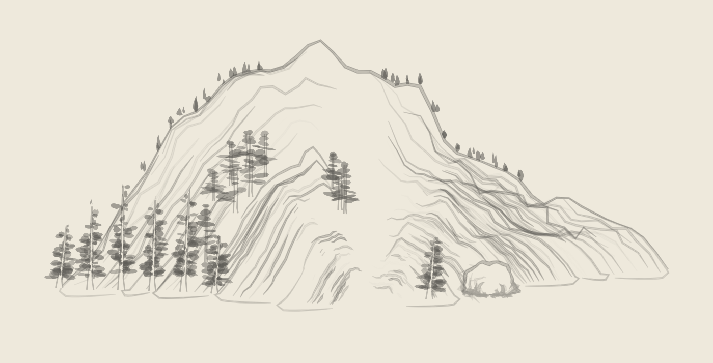

# Shan Shui Art Control Panel



An interactive control panel around [Lingdong Huang's](https://github.com/LingDong-/shan-shui-inf)
generative ink-painting program, *Shan, Shui*. Two views share one drawing
engine: a **mountain study** that walks a cosine curve through to a finished
brush drawing, and a **landscape** you travel through, drawn on demand in
deterministic 512-unit tiles.

## Quick start

```sh
npm install
npm run dev
```

| command | what it does |
| --- | --- |
| `npm run dev` | development server with hot reload |
| `npm run build` | type-checks and writes the production site to `dist/` |
| `npm run preview` | serves `dist/` locally — the build registers a service worker here, so a second load works offline |

Requires Node 18 or newer.

## Mountain study



One drawing, revealed in five stages:

1. **Generate cosine** — a clean, noise-free cosine arch.
2. **Add noise** — the same sample positions shaped by the original
   four-octave Perlin noise.
3. **Add details** — terrain-following trees and rocks where the generator
   places them.
4. **Inner contours** — the nine smaller profiles that guide the texture.
5. **Ink & shading** — those guides replaced by the finished brush marks.

**Controls**

- **Width** and **Height** set the arch (400–800 and 200–600).
- **Noise amount** blends every terrain profile from 0% (clean cosine) to
  100% (the original noisy profile); details and ink follow the same
  profiles.
- **Noise seed** (1–999,999) repeats a drawing exactly; **New seed** rolls a
  fresh one. The seed never re-rolls the first clean curve, and changing the
  noise amount never re-rolls the seed.
- **Play stages** advances through the five steps and stops; **Pause**
  freezes it, **Replay stages** starts again, **Back to cosine** resets.

The stages teach one completed drawing rather than replaying the original
program's execution order.

## Landscape

A header switch moves from the study to a camera that travels across a fixed
world. Only the tiles the camera actually touches are generated, and only once
navigation settles — a short debounce cancels anything that becomes stale.

**Controls**

- **West** / **East** buttons, dragging, scrolling, or the arrow keys
  (`←`/`→`, `PageUp`/`PageDown`). `Home` returns to the start.
- A **position** slider jumps anywhere along the route.
- **World seed** re-rolls the whole country; the same seed always draws the
  same world.

**Why the country never changes**

- Every tile is placed by its coordinates alone: world, cell and object seeds
  are hashed from the seed and the tile index, so a stretch of country returns
  unchanged however you travel to it.
- Objects near a tile edge are planned in both neighbouring tiles from shared
  plans and drawn byte-identically, so seams cannot diverge.
- Finished tiles are compressed into a bounded local archive (at most 64
  entries of 2 MiB each) in IndexedDB. Leaving the view releases them from
  live memory, revisits read them back, and anything evicted, unreadable, or
  over the limit is simply drawn again from its seed.
- Work stops when you hide the tab, change the world seed, keep moving, or
  leave the view.

## How it works

- **React 19 + TypeScript + Vite.** The output is SVG rather than canvas, so
  every drawing is inspectable markup.
- `public/generator.worker.js` runs the mountain call off the main thread and
  returns all ten profiles plus the finished SVG.
- `public/landscape.worker.js` and `public/landscape-core.js` plan and draw
  tiles from their coordinates, then serve them to the camera.
- The production build emits a service worker (`vite.config.ts`) that caches
  the site for offline reloads.

## Project structure

```
src/App.tsx                 the header switch, the five stages, study controls
src/Landscape.tsx           landscape camera, travel and worker lifecycle
src/ui/studio.css           the whole visual system
public/generator.worker.js  study geometry and finished SVG
public/landscape-core.js    tile planning and drawing from coordinates
public/landscape.worker.js  tile service and the IndexedDB archive
public/vendor/              upstream source, notices and licenses
media/                      screenshots used above
```

## Natural scenery only

The drawn world keeps mountains, trees, rocks, rivers and boats. The
transmission towers, pavilions, arches and huts that upstream plants on the
terrain — and the figures that stand beside them — are not part of this build,
so the finished artwork is not a byte-for-byte copy of upstream's.

The terrain geometry is untouched: the ridge, the inner profiles and the noise
blend are the originals.

## Source and licensing

Drawing source is pinned to `9f754d2b2e73495db7883d4d4055a7b0903b0454`.

Generator © 2018 Lingdong Huang, MIT; the embedded p5.js noise implementation
is LGPL-2.1. Notices and licenses live in [`public/vendor/`](public/vendor/).
